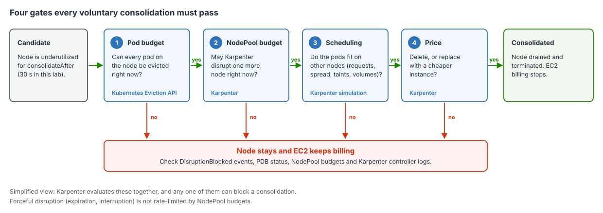
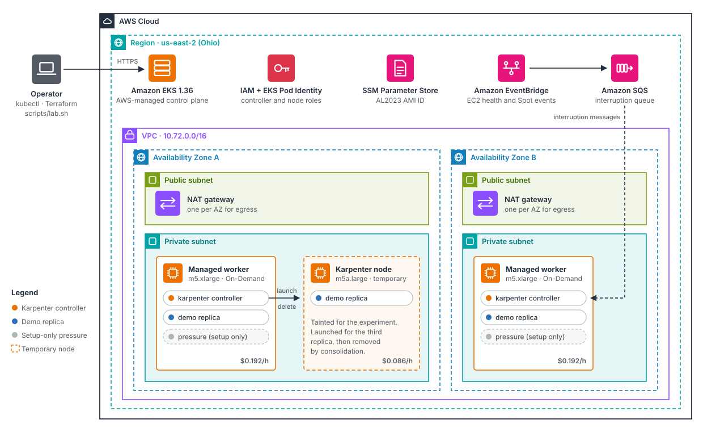
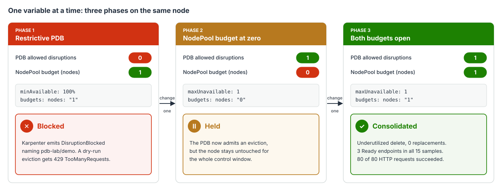
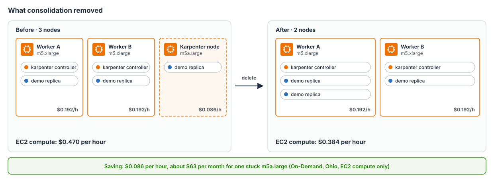

# The Hidden Cost of Kubernetes Availability: Why Karpenter Won't Consolidate Your EKS Nodes

*AWS Community Builders · 7-minute read · Hands-on lab included*

> **TL;DR**
>
> - A Pod Disruption Budget (PDB) that allows **zero** evictions pins its node. Karpenter can't consolidate it, and EC2 keeps billing.
> - Consolidation has to pass four gates: the pod budget, the NodePool budget, scheduling, and price. Any one of them can keep a node alive.
> - In a reproducible EKS lab, changing **one line** of a PDB let Karpenter remove an idle node. All 80 synthetic HTTP requests succeeded during the move.

---

## The node that wouldn't leave

It's month-end, and your EKS bill is higher than your traffic explains. You open the console and find a worker running at a fraction of its capacity. It hosts a single application pod, and the other workers have plenty of room for it.

Karpenter's consolidation is supposed to catch exactly this. It's on, and it's healthy. Yet the node has been there for weeks.

The culprit is usually one well-meant line of YAML:

```yaml
spec:
  minAvailable: 100%
```

Someone wanted the service to be "highly available," so they told Kubernetes that **no** replica may ever be voluntarily evicted. Kubernetes enforces that faithfully. Karpenter respects it too: it never forces a voluntary eviction past a PDB. So the node stays, and you pay for it.

This article explains why that happens, shows how to prove it in a lab you can run yourself, and covers how to set availability targets that don't quietly cost money.

## Four gates between "idle" and "gone"

When Karpenter sees an underutilized node, it doesn't just delete it. The node has to clear four independent checks:



| Gate | Question | Enforced by | Typical blocker |
| --- | --- | --- | --- |
| **1. Pod budget** | Can every pod on the node be evicted now? | Kubernetes Eviction API | `minAvailable: 100%`, `maxUnavailable: 0`, a one-replica service with `minAvailable: 1` |
| **2. NodePool budget** | May Karpenter disrupt another node now? | Karpenter | `budgets: - nodes: "0"`, or a schedule that blocks business hours |
| **3. Scheduling** | Do the pods fit elsewhere? | Karpenter's scheduling simulation | CPU requests, hard topology spread, taints, zonal volumes |
| **4. Price** | Is deleting or replacing the node cheaper? | Karpenter | No cheaper instance type is available |

The important insight: **these gates are independent**. Widening a PDB won't help if the NodePool budget is zero, and adding spare capacity won't help if the PDB forbids every eviction. You have to know *which* gate is closed.

> **Note:** Budgets only limit *voluntary* disruption. Node expiration and Spot interruptions are forceful, and NodePool disruption budgets don't rate-limit them. A PDB that blocks consolidation won't save you from those.

## The lab: an idle node on purpose

To make this measurable, I built a small, reproducible EKS environment with Terraform:



- **Amazon EKS 1.36** with a private API (an optional `/32` operator allowlist for laptop runs)
- **Two managed m5.xlarge workers**, one per Availability Zone, in private subnets with a NAT gateway each
- **Karpenter 1.14.4 (LTS)**: two controller replicas on the managed workers, EKS Pod Identity for AWS access, and an SQS queue fed by EventBridge for interruption events
- A **demo service**: three 1-vCPU replicas behind a ClusterIP Service, with HTTP readiness and a hard spread across two zones

The trick is creating a *legitimate* consolidation candidate:

1. A temporary DaemonSet reserves 2.1 vCPU on each managed worker, leaving room for exactly one demo replica each.
2. The third replica can't fit, so **Karpenter launches an m5a.large** for it.
3. The script removes the CPU reservation. Now all three replicas *could* run on the two managed workers, and the Karpenter node is pure overhead.

Workload, placement rules and replica count stay identical throughout. The only things that change are the two budgets.

## Three phases, one variable at a time



**Phase 1: restrictive PDB.** The NodePool allows one disruption, but the PDB allows none. To confirm the API agrees, the lab sends a *server-side dry-run* eviction. It's checked exactly like a real one, but it doesn't evict anything:

```bash
kubectl create --raw "/api/v1/namespaces/pdb-lab/pods/$POD/eviction?dryRun=All" -f eviction.json
# Error from server (TooManyRequests): Cannot evict pod as it would violate the pod's disruption budget.
```

Karpenter reaches the same conclusion and records it as a `DisruptionBlocked` event naming `pdb-lab/demo`.

**Phase 2: the PDB opens, the NodePool closes.** Swap the PDB for `maxUnavailable: 1` (with three Ready replicas, that allows one eviction) and set the NodePool budget to zero:

```bash
kubectl patch nodepool pdb-lab --type=merge \
  -p '{"spec":{"disruption":{"budgets":[{"nodes":"0"}]}}}'
```

Now the dry-run eviction is admitted, yet the node doesn't move. This is the control that proves gate 2 is independent of gate 1.

**Phase 3: both gates open.** Restore the budget to one. Karpenter logs an *underutilized* consolidation with `decision=delete` and zero replacement nodes. It drains the node and terminates the instance.

## What happened in the sandbox

Running EKS 1.36.5 and Karpenter 1.14.4 in Ohio, every phase behaved as predicted:

- **Phase 1:** `DisruptionBlocked` for `pdb-lab/demo`, and the dry-run eviction rejected with `TooManyRequests` (HTTP 429).
- **Phase 2:** the eviction was admitted, and the node stayed untouched for the whole 180-second control window.
- **Phase 3:** once the budget was restored, Karpenter started disrupting the node after 26 seconds and removed it after 72. It was an underutilized delete with no replacement node. EC2 reported the m5a.large as `terminated`, and the three replicas landed on the two managed workers.

The availability check matters as much as the savings. While the node drained, a probe sampled the Service's Ready endpoints, and a short-lived pod sent HTTP requests every second:

- **15 of 15** endpoint samples showed three Ready replicas
- **80 of 80** HTTP requests succeeded



At public Ohio On-Demand prices, EC2 compute fell from **$0.470/hour to $0.384/hour**. That's about **$63 a month for a single stuck m5a.large**, before EKS, networking, storage or discounts. Multiply by every over-protected service in your fleet, and "high availability" starts showing up as a budget line.

> **Honest caveats:** this is one voluntary consolidation with synthetic traffic, and the sampling could miss very short readiness gaps. The lab also measures how long Karpenter takes to act once allowed: 26 seconds here. The 180-second Phase 2 window was nearly seven times that, so the "held" result can't be explained by Karpenter simply not having acted yet.

## Debugging a node that won't go away

Walk the gates in order. Each has a quick command:

```bash
# Gate 1: which PDBs allow zero disruptions?
kubectl get pdb -A                       # check the ALLOWED DISRUPTIONS column

# What did Karpenter say about it?
kubectl get events -A --field-selector reason=DisruptionBlocked

# Gate 2: is the NodePool budget closed (or closed by schedule)?
kubectl get nodepool <name> -o jsonpath='{.spec.disruption}{"\n"}'

# Gate 3: do the pods fit? Look at requests, not CPU graphs
kubectl describe node <node>             # Allocated resources, taints, labels

# Everything else: the controller's own reasoning
kubectl -n kube-system logs -l app.kubernetes.io/name=karpenter -c controller --since=15m
```

Two traps to watch for:

- **Stale events.** A `DisruptionBlocked` event can outlive the policy that caused it. Always check timestamps.
- **Utilization graphs.** A node at 10% CPU usage can still be "full" if its pods *request* 90%. Scheduling uses requests, not usage.

## Choosing a PDB that doesn't cost you

| If your service has… | Use | Why |
| --- | --- | --- |
| 3 or more replicas | `maxUnavailable: 1` (or a percentage) | One pod moves at a time; the rest keep serving |
| 2 replicas | `maxUnavailable: 1`, plus spare capacity and spread across zones | Allows moves while one replica stays up |
| 1 replica | Reconsider the PDB, or accept that the node is pinned | `minAvailable: 1` on a single replica blocks every voluntary eviction |
| Pods stuck not-Ready | `unhealthyPodEvictionPolicy: AlwaysAllow` | Unhealthy pods don't hold a node hostage |

And make the trade-off explicit. For a genuinely critical singleton, keeping a node may be the right call. Just make it a decision rather than a side effect of copy-pasted YAML.

One more caution: with three replicas spread 2+1 across two zones, losing the larger zone leaves **one** replica. Size for zone failure separately from voluntary disruption, and test both.

## Key takeaways

1. **`minAvailable: 100%` means "never move this voluntarily."** That includes cost optimization.
2. **Consolidation has four independent gates.** Find out which one is closed before changing anything.
3. **Dry-run evictions are a free, safe test** of what the API will allow.
4. **Prove availability while you save money.** Sample Ready endpoints and real requests during the move.
5. **Budgets don't protect against forceful disruption.** Expiration and interruption still drain nodes.

## Try it yourself

The full lab includes Terraform for both roots, the manifests, and a script that runs and checks each phase. It's in the [README](README.md). Expect roughly **$0.66/hour** for the EKS control plane, NAT gateways and EC2 compute while it runs, and tear it down as soon as you're done.

---

**References:** [Karpenter disruption and budgets](https://karpenter.sh/v1.14/concepts/disruption/) · [Kubernetes disruptions](https://kubernetes.io/docs/concepts/workloads/pods/disruptions/) · [Configuring a PDB](https://kubernetes.io/docs/tasks/run-application/configure-pdb/) · [Topology spread constraints](https://kubernetes.io/docs/concepts/scheduling-eviction/topology-spread-constraints/) · [Amazon EKS Karpenter best practices](https://docs.aws.amazon.com/eks/latest/best-practices/karpenter.html) · [AWS Price List Query API](https://docs.aws.amazon.com/awsaccountbilling/latest/aboutv2/using-price-list-query-api.html)

*Diagrams are original drawings in the AWS architecture diagram style.*
