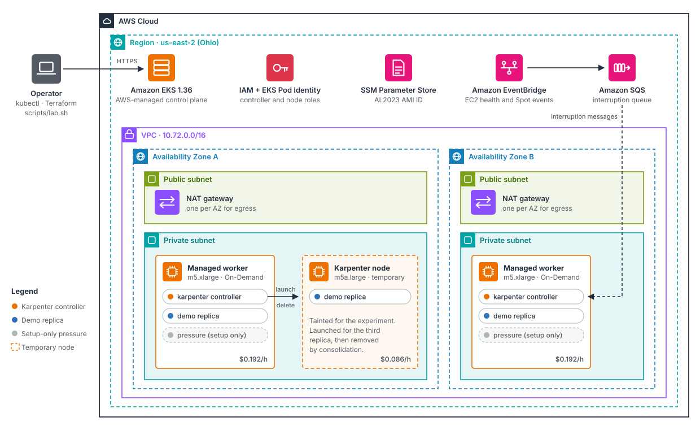

# The Hidden Cost of Kubernetes Availability

A hands-on lab for diagnosing why Karpenter keeps an underutilized EKS node. Compare a restrictive Pod Disruption Budget (PDB), a zero NodePool disruption budget, and a successful consolidation while holding workload placement and capacity constant.

Read the [illustrated article](ARTICLE.md) or run the experiment below.

> [!WARNING]
> This lab creates billable AWS resources: an EKS cluster, two NAT gateways and three EC2 instances, about **$0.66/hour** in Ohio. Use a disposable sandbox account and [tear it down](#tear-down) as soon as you finish.



## What you'll learn

- The four independent gates every Karpenter consolidation must pass: pod budget, NodePool budget, scheduling and price
- How a PDB and a NodePool disruption budget each block a node on their own, proven with server-side dry-run evictions and Karpenter events
- How to measure availability while a node is consolidated, using Ready endpoint samples and live HTTP requests

## Contents

- [Quick start](#quick-start)
- [Verified sandbox results](#verified-sandbox-results)
- [Versions and topology](#versions-and-topology)
- [Prerequisites](#prerequisites)
- [Deploy](#deploy)
- [Run and validate](#run-and-validate)
- [Diagnose a failed run](#diagnose-a-failed-run)
- [Tear down](#tear-down)
- [Production deployment settings](#production-deployment-settings)
- [Repository layout](#repository-layout)
- [License](#license)

## Quick start

1. Check the [prerequisites](#prerequisites) and copy `infra/terraform.tfvars.example` to `infra/terraform.tfvars`.
2. [Deploy](#deploy) the `infra` root, write the kubeconfig, then deploy the `controller` root.
3. [Run](#run-and-validate) `./scripts/lab.sh setup` and the three phases, saving output to `evidence/`.
4. [Tear down](#tear-down) with `./scripts/lab.sh cleanup`, then destroy `controller` and `infra`.

A full run takes about an hour, most of it EKS creation and deletion.

## Verified sandbox results

EKS 1.36.5 (platform `eks.19`) and Karpenter 1.14.4 ran in Ohio on 2026-11-22, with AL2023 AMI `ami-03e3be531e9dd9be1` for every worker. Both Karpenter controllers were Ready on different managed workers. The initial placement had three Ready demo pods across three workers, and the busybox image pulled from `public.ecr.aws`.

| Phase | Observed result |
| --- | --- |
| Restrictive | With `minAvailable: 100%`, the PDB allowed zero evictions. Karpenter emitted `DisruptionBlocked` naming `pdb-lab/demo`. The API rejected the dry-run eviction with `TooManyRequests`. |
| NodePool control | With `maxUnavailable: 1`, the API admitted the dry-run eviction. The same worker stayed untouched for the whole 180-second control window with zero NodePool allowance. |
| Permissive | After the budget was restored, Karpenter started disrupting the node in 26 seconds and removed it in 72 seconds, well inside half the control window. It logged an underutilized `delete` with zero replacement nodes. Three replicas recovered across two workers. All 15 EndpointSlice samples found three Ready endpoints, and all 80 synthetic HTTP requests succeeded. EC2 reported the temporary On-Demand `m5a.large` as `terminated`. |

The experiment covers one voluntary consolidation with synthetic requests. Shorter changes can fall between samples. Public Ohio Linux On-Demand pricing put the two managed workers and temporary worker at $0.470/hour combined. Removing the $0.086/hour temporary worker left $0.384/hour in EC2 compute. The estimate excludes EKS, networking, storage and discounts. [AWS Price List Query API](https://docs.aws.amazon.com/awsaccountbilling/latest/aboutv2/using-price-list-query-api.html).

## Versions and topology

| Component | Lab choice |
| --- | --- |
| Amazon EKS | Kubernetes 1.36, standard support |
| Karpenter | Controller and CRD charts 1.14.4 LTS |
| Manifest APIs | `karpenter.sh/v1`, `karpenter.k8s.aws/v1`, `policy/v1` |
| Workers | Two managed On-Demand workers across two AZs and one temporary Karpenter worker |
| Networking | Private workers and one NAT gateway per AZ, private API by default with an optional operator-only public endpoint |
| Controller | Two replicas on distinct managed workers |
| Identity | EKS Pod Identity for the controller and a separate node IAM role and access entry |

The [Karpenter 1.14 compatibility matrix](https://karpenter.sh/v1.14/upgrading/compatibility/) lists Karpenter 1.13 or later for Kubernetes 1.36. See the [1.14.4 LTS release](https://github.com/aws/karpenter-provider-aws/releases/tag/v1.14.4) and [EKS support calendar](https://docs.aws.amazon.com/eks/latest/userguide/kubernetes-versions.html). Terraform installs the CRDs ahead of the controller. It resolves the recommended regional AL2023 AMI from SSM, and setup writes that exact ID into the EC2NodeClass. Record the ID alongside evidence when comparing runs. EKS add-on and managed node AMI defaults may change over time.

## Prerequisites

- [ ] A disposable AWS sandbox account, used by one operator
- [ ] A region with EKS 1.36 and the `m5.xlarge`, `m5.large` and `m5a.large` instance types. The default is Ohio (`us-east-2`)
- [ ] Terraform 1.12+, AWS CLI v2, kubectl within one minor version of the cluster, Bash and jq
- [ ] An authenticated AWS profile with EKS, VPC/EC2, IAM, SSM, CloudWatch, SQS and EventBridge provisioning permissions. The Terraform caller is temporarily granted cluster admin
- [ ] The default cluster name `karpenter-pdb-lab` is unused, or you set `cluster_name` in `infra/terraform.tfvars`
- [ ] A billing alert on the sandbox account

Budget time for both setup and teardown. The EKS control plane and two Ohio NAT gateways together currently cost $0.19/hour before worker instances, EBS, IPv4, traffic and logging. Estimate those charges for your region before applying. The NodePool's two-vCPU limit and two fixed managed node groups constrain expected capacity. Karpenter checks limits eventually, so the limit is approximate during concurrent launches. [EKS pricing](https://aws.amazon.com/eks/pricing/), [VPC pricing](https://aws.amazon.com/vpc/pricing/), [Karpenter NodePools](https://karpenter.sh/v1.14/concepts/nodepools/).

## Deploy

From the repository root, set `AWS_PROFILE` if you use a named profile. Replace both example values in `infra/terraform.tfvars` with the output account ID and your real public IPv4 CIDR. Setting `operator_cidr` turns on a public API endpoint restricted to that one address, so these steps can run from a laptop. Remove the line to keep the API private, and run the steps from inside the VPC instead.

```bash
aws sts get-caller-identity
cp infra/terraform.tfvars.example infra/terraform.tfvars
# Edit infra/terraform.tfvars before continuing.
terraform -chdir=infra init
terraform -chdir=infra validate
terraform -chdir=infra plan -out=lab.tfplan
terraform -chdir=infra apply lab.tfplan

REGION=$(terraform -chdir=infra output -raw region)
CLUSTER=$(terraform -chdir=infra output -raw cluster_name)
aws eks update-kubeconfig --region "$REGION" --name "$CLUSTER" \
  --alias karpenter-pdb-lab --kubeconfig "$PWD/lab.kubeconfig"
chmod 600 lab.kubeconfig
export KUBECONFIG="$PWD/lab.kubeconfig"
export TF_VAR_kubeconfig="$KUBECONFIG"
export TF_VAR_cluster_name="$CLUSTER"
export TF_VAR_interruption_queue="$(terraform -chdir=infra output -raw interruption_queue)"

terraform -chdir=controller init
terraform -chdir=controller validate
terraform -chdir=controller plan -out=lab.tfplan
terraform -chdir=controller apply lab.tfplan

kubectl version
kubectl api-resources --api-group=karpenter.sh
kubectl api-resources --api-group=karpenter.k8s.aws
kubectl -n kube-system get deployment karpenter -o jsonpath='{.spec.template.spec.containers[0].image}{"\n"}'
```

Terraform uses separate infrastructure and controller states so Helm connects after EKS exists and can be removed while the API is available. Keep both states and the dedicated kubeconfig until teardown finishes. Treat state and plans as sensitive. Use the same AWS identity and profile throughout.

## Run and validate

`setup` applies a temporary DaemonSet that reserves 2.1 vCPU per managed worker. Each has room for one 1-vCPU demo replica, and the third replica triggers one Karpenter launch. Setup verifies three replicas on three nodes, then removes the temporary pressure while keeping the workload and placement rules unchanged. It finishes only after Karpenter emits a `DisruptionBlocked` event naming `pdb-lab/demo`, so the restrictive evidence always contains the blocker. The demo uses HTTP readiness, a ClusterIP Service and a hard spread across two AZs.

The NodePool control phase watches the candidate for `CONTROL_WINDOW` seconds (default 180). The final phase prints how long Karpenter took to start disrupting and to remove the node after the budget is restored, and warns if the control window was shorter than twice that delay. A zero budget only proves something if Karpenter would otherwise have acted within the window.

```bash
set -o pipefail
./scripts/lab.sh setup
# Set NODE to the Karpenter node name printed by setup.
NODE="replace-with-node-name"
mkdir -p evidence
./scripts/lab.sh observe "$NODE" | tee evidence/01-restrictive.txt
./scripts/lab.sh probe-eviction blocked "$NODE"
./scripts/lab.sh budget-control "$NODE" | tee evidence/02-nodepool-budget.txt
./scripts/lab.sh probe-eviction allowed "$NODE"
./scripts/lab.sh consolidate "$NODE" | tee evidence/03-permissive.txt
```

Set `NODE` to the name printed by setup. Setup has already confirmed the `DisruptionBlocked` event. Its timestamp appears in the restrictive evidence. If the final phase warns that the control window was too short, rerun the lab with the suggested `CONTROL_WINDOW` value before citing the NodePool result.

| Phase | PDB allowance | NodePool allowance | Pass condition |
| --- | --- | --- | --- |
| Restrictive | 0 | 1 | Karpenter emits `DisruptionBlocked` naming `pdb-lab/demo`. Three replicas stay Ready, including the pod on the experiment node. The API rejects a dry-run eviction because of the PDB. |
| NodePool control | 1 | 0 | For the whole control window, the node has no deletion timestamp and no `karpenter.sh/disrupted` taint. The API admits a dry-run eviction. A prior PDB event may still be visible. |
| Permissive | 1 before eviction | 1 | Karpenter removes the original NodeClaim and Node, and the demo returns to three Ready endpoints on the two baseline nodes. No sample falls below two Ready endpoints, all sampled HTTP requests succeed, and zero lab NodeClaims remain. The disruption delay is less than half the control window. |

The eviction probes send server-side dry-run requests and keep the pod in place. The final phase samples distinct Ready EndpointSlice targets and checks repeated HTTP requests from a short-lived in-cluster pod. These samples cover the lab's observation window and traffic path. Events are asynchronous and may be deduplicated or expire. Read their timestamps and use controller logs to confirm the final operation was an underutilized consolidation with deletion, rather than drift or an EC2 health event. Capture the original provider ID before the last step if you also want to confirm the EC2 instance terminates.

`evidence/` is gitignored because it contains account-specific node names, instance IDs and logs. Share only sanitized summaries.

## Diagnose a failed run

| Gate | What to check |
| --- | --- |
| Pod eviction | Use `kubectl -n pdb-lab describe pdb demo` to check selector, health, observed generation and allowed disruptions. Inspect all non-DaemonSet pods on the candidate and all PDBs in their namespaces. An overlapping selector or a do-not-disrupt annotation can independently block the node. |
| Node disruption | Inspect NodePool budgets and reason filters, schedules, readiness and nodes already deleting. A zero budget can leave a node in place even when the PDB permits eviction. |
| Scheduling | Inspect baseline readiness, cordon state, taints, labels and allocated requests with `kubectl describe node`. Check affinity, topology, PVC/AZ constraints and pod slots. Current CPU utilization does not establish whether requests and placement constraints fit. |
| Economics | Inspect the candidate events and controller logs for missing cheaper offerings. Karpenter can delete a node if pods fit on existing capacity, or replace it when a feasible lower-priced option exists. The lab aims for deletion without replacement. |
| Provisioning | If setup times out, describe the EC2NodeClass and NodeClaim and check the controller logs for IAM, subnet/tag, AMI or insufficient capacity errors. Check the pressure DaemonSet and allocated CPU requests on both baseline nodes. |

Use the [Karpenter 1.14 disruption guide](https://karpenter.sh/v1.14/concepts/disruption/) and [Kubernetes PDB documentation](https://kubernetes.io/docs/tasks/run-application/configure-pdb/) for the behavior of each gate.

## Tear down

Delete workload and Karpenter-managed instances while the controller, its IAM permissions and the cluster API are still available. If you stopped before installing the controller or creating any experiment objects, destroy only the Terraform roots you applied. Run the exports from the repository root so teardown also works in a new shell.

```bash
REGION=$(terraform -chdir=infra output -raw region)
CLUSTER=$(terraform -chdir=infra output -raw cluster_name)
export KUBECONFIG="$PWD/lab.kubeconfig"
export TF_VAR_kubeconfig="$KUBECONFIG"
export TF_VAR_cluster_name="$CLUSTER"
export TF_VAR_interruption_queue="$(terraform -chdir=infra output -raw interruption_queue)"

./scripts/lab.sh cleanup
terraform -chdir=controller destroy
terraform -chdir=infra destroy

aws eks describe-cluster --region "$REGION" --name "$CLUSTER"
aws ec2 describe-instances --region "$REGION" --filters \
  "Name=tag:Project,Values=$CLUSTER" \
  "Name=instance-state-name,Values=pending,running,stopping,stopped" \
  --query 'Reservations[].Instances[].InstanceId'
aws ec2 describe-nat-gateways --region "$REGION" --filter \
  "Name=tag:Project,Values=$CLUSTER" \
  "Name=state,Values=pending,available,deleting" \
  --query 'NatGateways[].NatGatewayId'
```

Expect `ResourceNotFoundException` from EKS and empty EC2 and NAT results after deletions settle. Review AWS for EBS volumes, elastic IPs and log groups if destroy reported errors. Keep state and retry the affected destroy while the necessary dependencies still exist. The cluster's KMS key enters a pending-deletion window and is removed automatically.

## Production deployment settings

Run Terraform and kubectl from a runner with VPC access. Omit `operator_cidr` to keep the API private. Use a separate, versioned and encrypted S3 state bucket with public access blocked. In each Terraform root, copy `backend.tf.example` to `backend.tf` ([infra](infra/backend.tf.example), [controller](controller/backend.tf.example)) and replace the bucket name. Each example already uses its own state key. Restrict access to the keys and their lockfiles. Configure these backends before the first apply or use Terraform's backend migration to move existing state. Use a dedicated deployment role and scope ongoing Kubernetes access through EKS access entries.

The test NodePool has a two-vCPU cap and expiration disabled to isolate the experiment. Configure production capacity limits, instance diversity, AMI rollout and expiry for your maintenance policy. The two-endpoint test covers one voluntary eviction. With three replicas split 2+1 across two AZs, the loss of the larger AZ can leave one Ready replica. Size and test AZ failure and request-level availability separately. [Amazon EKS data plane best practices](https://docs.aws.amazon.com/eks/latest/best-practices/data-plane.html), [Karpenter disruption](https://karpenter.sh/v1.14/concepts/disruption/).

## Repository layout

```text
infra/        VPC, EKS cluster, managed workers, Karpenter IAM and interruption queue
controller/   Karpenter CRD and controller Helm releases
manifests/    EC2NodeClass, NodePool, demo workload, PDBs, pressure DaemonSet, probe
scripts/      lab.sh runs and checks each phase, and cleans up
docs/         Diagram generator, SVG diagrams and PNG exports
ARTICLE.md    The illustrated article
```

Each Terraform root splits its configuration by purpose.

| File | Contents |
| --- | --- |
| `versions.tf` | Terraform and provider version constraints |
| `providers.tf` | Provider configuration |
| `variables.tf` | Typed, described and validated inputs |
| `locals.tf` | Derived values such as AZs, subnet ranges and tags |
| `data.tf` | Data sources (`infra` only) |
| `backend.tf.example` | S3 remote state template with a per-root key. Copy to `backend.tf` to use it |
| `vpc.tf`, `eks.tf`, `karpenter.tf` | One file per component |
| `outputs.tf` | Described outputs consumed by the next root or `scripts/lab.sh` |

The defaults of `cluster_name`, `kubernetes_version`, `vpc_cidr` and `karpenter_version` reproduce the verified run. `docs/images/` holds the diagrams as SVG, with PNG exports under `png/` for platforms that don't render SVG. Regenerate the SVGs with `python3 docs/diagrams.py docs/images`.

### Repository checks

CI checks Terraform formatting and configuration, shell syntax and ShellCheck. Workflow actions are pinned to commit SHAs, and Dependabot proposes monthly updates. The demo images come from the ECR Public mirror of Docker Official Images to avoid anonymous Docker Hub pull limits behind shared NAT addresses. Pin them by digest for long-lived copies of this lab, for example with `crane digest public.ecr.aws/docker/library/busybox:1.37.0`.

## Security

Report vulnerabilities privately as described in [SECURITY.md](SECURITY.md).

## License

- Code (Terraform, manifests, scripts and the diagram generator): [MIT](LICENSE)
- Article, README and diagrams: [CC BY 4.0](LICENSE-docs)

## Author

Elyas Syed ([@elyas-syed](https://github.com/elyas-syed)), AWS Community Builder.
